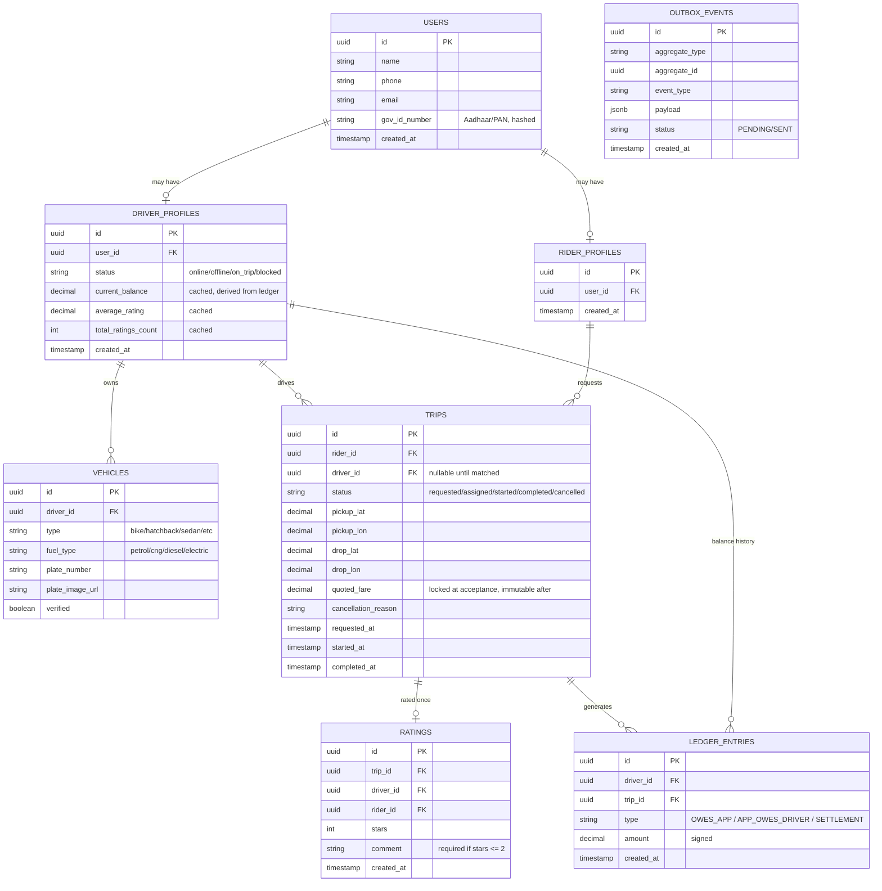
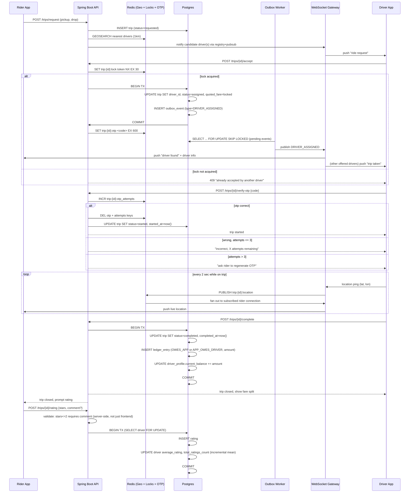

# Cab Service — Core Loop System Design

Covers: request → match → accept (lock) → OTP → live tracking → trip end → payment → rating.
Secondary modules (bidding/re-search, trust score, Aadhaar/PAN blocking, plate OCR, admin) are deliberately out of this doc — each gets its own design pass before it's built.

---

## 1. Data store split — Postgres vs Redis

| Data | Store | Why |
|---|---|---|
| users, driver/rider profiles, vehicles | Postgres | durable, relational |
| trips (status, fare, pickup/drop) | Postgres | source of truth, audited |
| ledger_entries | Postgres | immutable financial audit trail |
| ratings | Postgres | durable |
| outbox_events | Postgres | durable, consumed by worker |
| driver live location (geo index) | Redis (GEOADD) | high-frequency writes, sub-ms nearest-search |
| trip accept lock + fencing token | Redis (SET NX EX) | short-lived, self-expiring |
| OTP + attempt/regen counters | Redis (SET EX / INCR) | short-lived, single-purpose |
| driver connection registry (which WS server) | Redis | shared across WS server instances |
| live location pub/sub during trip | Redis Pub/Sub | ephemeral, latest-wins, no durability needed |

---

## 2. Core Postgres tables (columns, not exhaustive types)



**Indexes worth calling out explicitly:**
- `outbox_events (status, created_at)` — composite, for the worker's polling query
- `trips (rider_id, status)`, `trips (driver_id, status)` — for history screens
- `ledger_entries (driver_id, created_at)` — for the driver's transaction list

---

## 3. Core loop — sequence diagram



---

## 4. Redis key patterns, consolidated

```
drivers:geo                         -- GEOADD set, all online drivers
trip:{id}:lock            = token   -- EX 30, fencing token for accept race
trip:{id}:otp             = code    -- EX 600
trip:{id}:otp_attempts    = int     -- INCR, no separate TTL beyond otp window
trip:{id}:otp_regen_count = int     -- caps total regenerations at 3
trip:{id}:last_location   = {lat,lon} -- EX 60, overwrite only
conn:driver:{id}          = serverX -- WS connection registry
channel: trip:{id}:location         -- pub/sub, ephemeral
channel: serverX:outbox             -- pub/sub, cross-server event delivery
```

---

## 5. What's deliberately deferred (not v1)

- Bidding / fare-increase re-search loop
- Driver trust-score system (early-end frequency, OTP-failure pattern, detour detection)
- Aadhaar/PAN-linked blocking + email notifications
- Plate-number OCR verification
- Super-admin tooling
- Full trip-path history (only start/end stored in v1)
- Road-distance-aware matching (S2/H3 + routing-engine two-phase search) — v1 can start with straight-line radius search, upgrade later

---

## 6. Build order from here

1. Postgres schema (above) + Flyway/Liquibase migrations
2. Auth (rider/driver/user, JWT)
3. Request → match (straight-line Redis geo search first, no OTP/lock yet) — get a driver visibly "found"
4. Accept flow with SETNX + fencing token + outbox
5. OTP verify
6. WebSocket location streaming
7. Trip completion + ledger + cached balance
8. Rating
9. Dockerize all of it, deploy
10. Only then: layer in secondary modules one at a time
